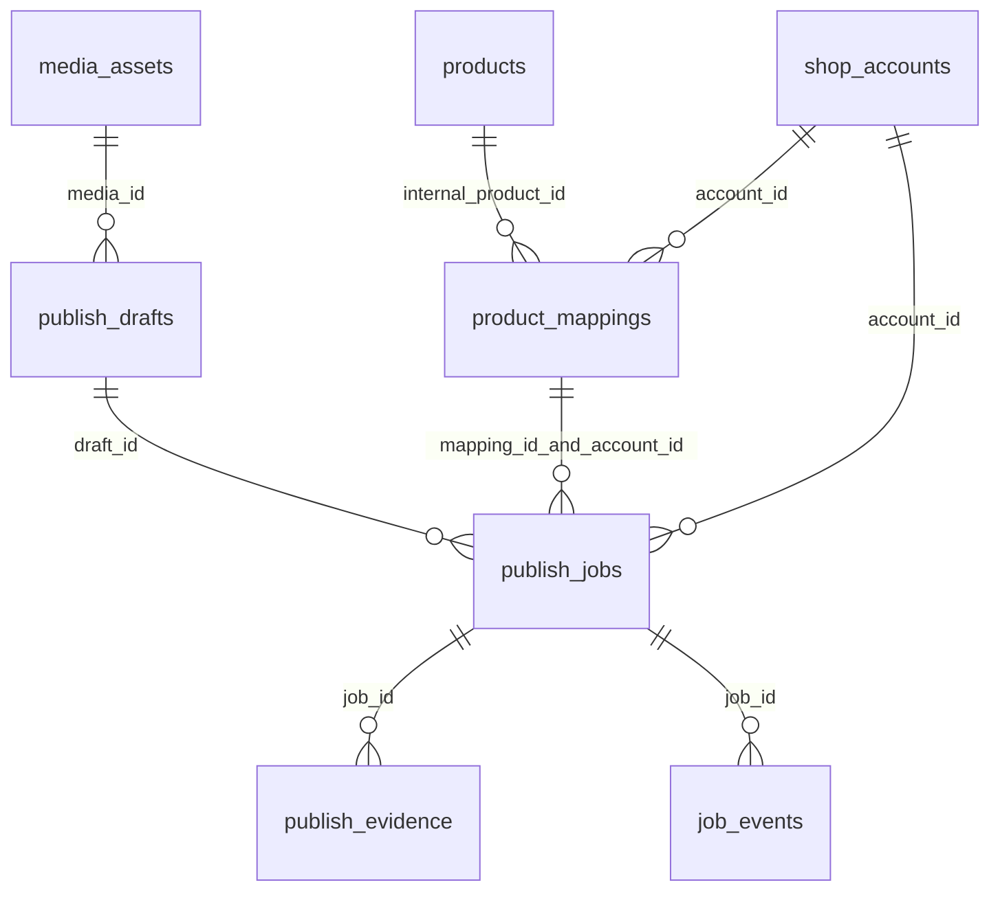

# ER 草案（迁移 0001）

| 表 | 关键字段和约束 |
|---|---|
| media_assets | id；path；sha256 唯一；duration_ms/width/height/cover_path；created_at |
| products | id；internal_sku 唯一；name/category/attributes |
| shop_accounts | id；platform 枚举；shop_id；(platform,shop_id)唯一；profile_key 唯一；login_status/last_checked_at |
| product_mappings | internal_product_id 是内部 products 外键；external_product_id 是店铺实际商品 ID，非空字符串；同 account+内部商品、account+外部ID 各唯一 |
| publish_drafts | media_id；title/description/tags/cover_path/platform_fields；version>0 |
| publish_jobs | draft/account/mapping；publish_version>0；schedule_at；status 枚举；attempt_count>=0；唯一幂等键和(draft,account,version)；target_snapshot |
| publish_evidence | job_id；kind=post/product；verification_status；post_id/post_url/product_id_seen/reference/observed_at/target_snapshot；verified 时必有作品和证据，商品项另必有商品ID |
| job_events | job_id/timestamp/stage/outcome/error_code/message；将来只能存脱敏事件 |

所有时间由未来服务写 UTC ISO8601，UI 转本地时区。媒体存在性/哈希真实性、账户身份、商品权限不能靠 DB 证明，必须由 G2/G3 服务校验。草稿冻结、快照不可变、证据与任务状态原子保存、队列租约/串行执行是后续任务，G1 不宣称实现。普通视频不在当前带货任务数据路径：mapping_id 不允许为空。
