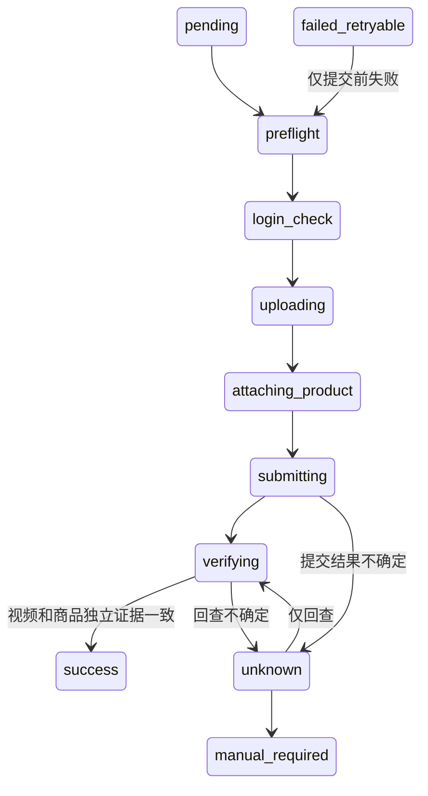

# Adapter 契约与状态策略

可执行定义：app/backend/domain/contracts.py、state_machine.py；当前无执行 worker。六个平台同一 Protocol：check_login、validate_content、resolve_product、upload_media、attach_product、submit、verify_post、verify_product。结果以 outcome + 类型化 data + ErrorCode 表示；证据包含 job_id、准确目标身份、local reference。

提交前状态允许 manual_required / failed_retryable / failed_permanent / cancelled；submitting/verifying 仅允许下一安全阶段、unknown 或 manual_required，不允许 cancelled 假装撤回远端行为，也不允许直接自动重试。success/cancelled/failed_permanent 是终态；manual_required 在 G1 没有恢复出口，未来人工核验动作须单独审计，不可简单“强制成功”。

| 错误 | 后续 worker 必须采用的策略（未实现） |
|---|---|
| unsupported | 功能未实现或能力缺失，不提交 |
| login_required / risk_challenge | 人工扫码/官方验证，停止自动化 |
| invalid_content | 修改内容后重建/预检 |
| product_not_found / product_permission | 阻断，不降级普通视频 |
| product_ambiguous / identity_mismatch | 人工处理，禁止首条匹配 |
| transient_before_submit | 有限重试仅限已证明未提交阶段 |
| submission_unknown | 先回查，禁止重新 submit |
| verification_unavailable | manual_required，保存视频/商品各自结果 |

resolve_product 必须实现店铺内准确 ID 唯一匹配；ProductResolution.match_count 必须为1，发布前 ProductAttachmentEvidence 再确认相同 ID。G1 只定义类型，尚无真实选择器或预提交执行器。success 守卫已单测：两项证据 verified、job/target/post_id 一致、product_id_seen 精确相等、证据引用非空；缺任一项不能成功。
